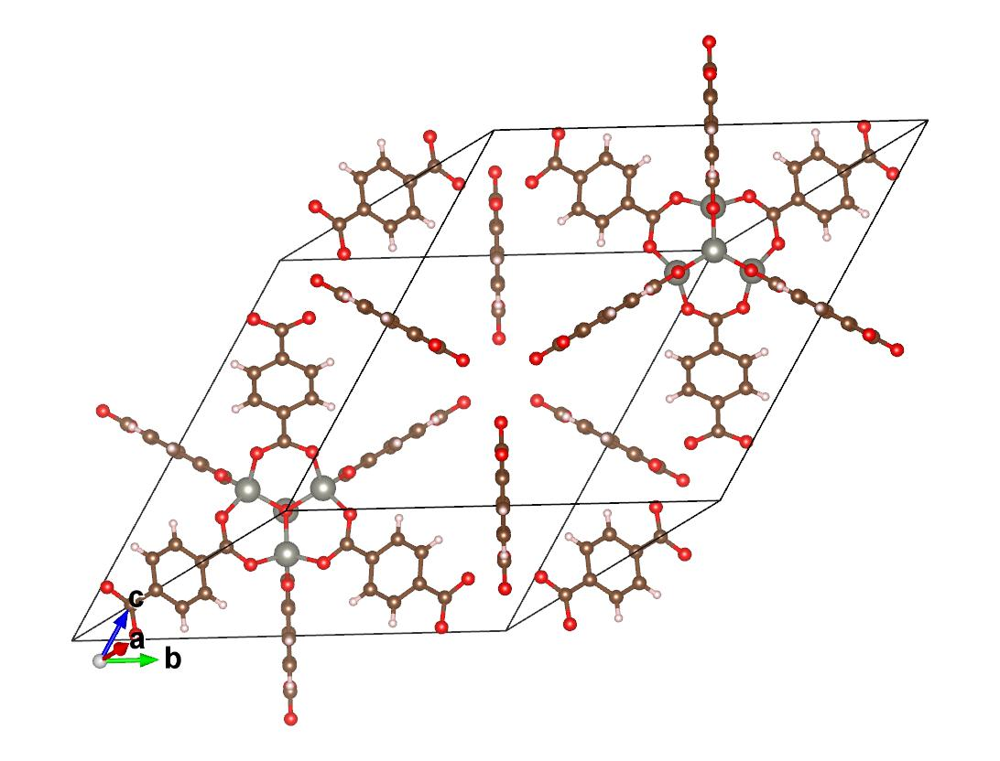
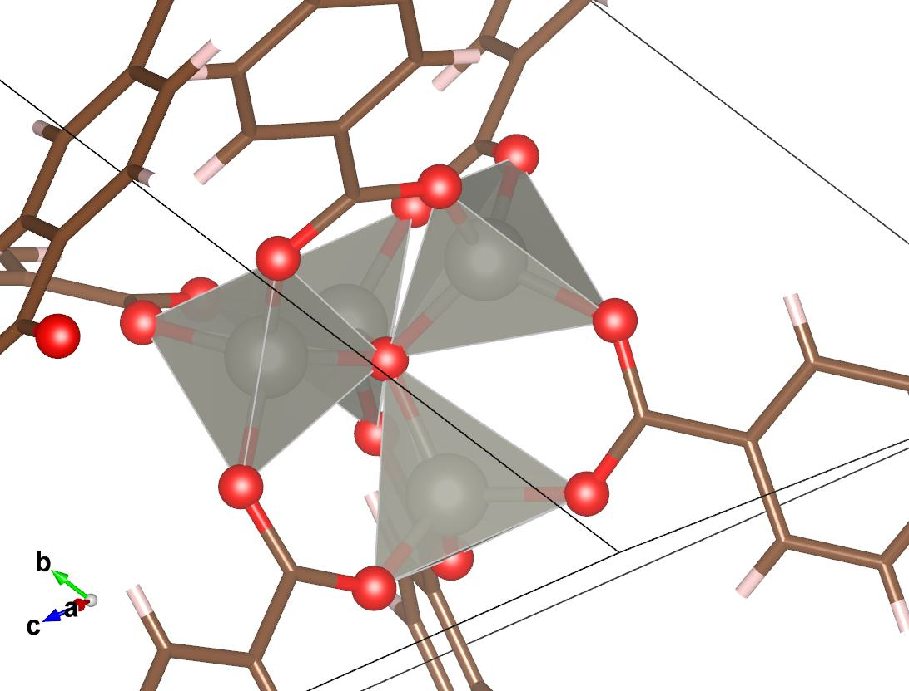
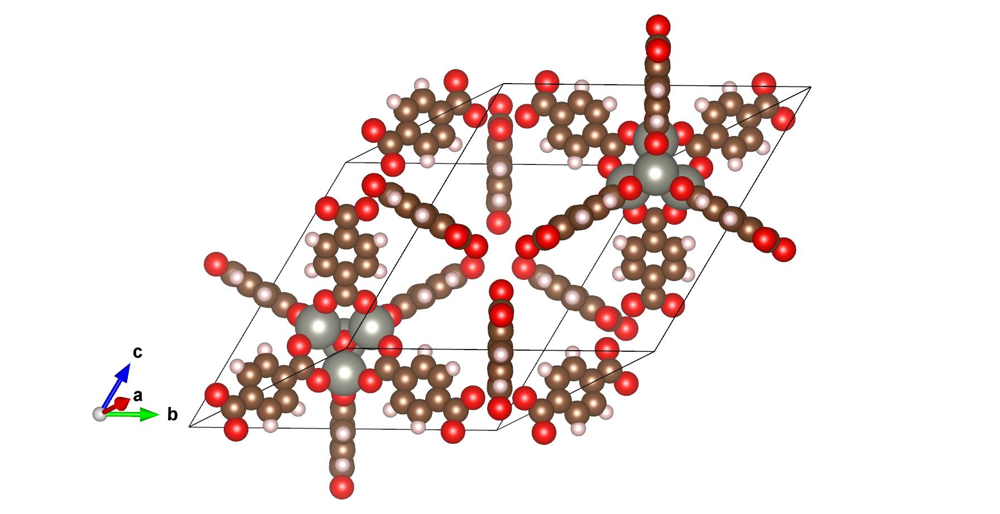

# 第 2 章：CIF 与结构体检

## 本章目的

学完这一章，你应该能：

- 打开 CIF，判断它是不是“能直接算”的结构；
- 知道 PBC、对称性、无序、溶剂、缺失 H 对计算意味着什么；
- 用结构体检工具读出原子数、密度、最短距离、金属配位；
- 把常规胞约化成原胞，并知道什么时候不能这么做。

图 2-1：MOF-5（IRMOF-1）原胞，VESTA 渲染。106 原子，C48H24O26Zn8；a=b=c=18.266 Å、α=β=γ=60°，所以外观是菱方而不是立方。灰球 Zn、红 O、棕 C、浅粉 H。看图时先确认三件事：Zn4O 节点完整、BDC 连接没有断、孔道是通的。

## 计算背景速查

| 词 | 计算含义 | 为什么重要 |
|---|---|---|
| CIF（计算输入） | 读入后先检查 cell、原子数、占据、对称性 | 计算结构描述不完整会直接污染结果 |
| PBC / 周期性边界 | 用一个小盒子代表无限晶体；所有距离用最小镜像 | 分子跨边界会“看起来断键” |
| 晶胞 / cell | 计算的周期盒子；决定真空层/超胞 | 盒子太小会有镜像相互作用 |
| 分数坐标 | CIF 常用的坐标表示；改结构时注意 wrap | 原子跨边界时坐标会跳 |
| 对称性 | 用于约化原胞、生成等价位点 | 约化会改变原子数/能量参考 |
| 无序 / disorder | 同一个位置统计上可能是两种原子/取向 | 直接算会选错 |
| 溶剂 / guest | 孔道里残留的水/DMF 等 | 不删会挡住吸附位点 |
| 活化 | 加热/真空把溶剂去掉，得到空孔 | 实验和计算不是同一个结构 |
| 配位数 CN | 一个金属周围连着几个 O/N | 判断结构是否合理 |
| BVS | 键价和，用来估计金属价态 | 判断 Zn/Mg/Zr 是否欠配位 |
| 空隙率 | 孔道占晶胞体积的比例 | 判断能不能装分子 |

## 做法

### 步骤 1：先看，不要先算

- 用 VESTA 打开 CIF；
- 看晶胞是否合理（a,b,c 不要是 1 Å 或 1000 Å）；
- 看孔道里有没有溶剂；
- 看金属节点配位是否完整；
- 看有没有明显重叠原子。

### 步骤 2：跑结构体检

    .venv_mace/bin/python one_click_mof/tools/structure_check.py \
      --cif 你的.cif \
      --out structure_check.json

读 JSON 里的：

- natoms、formula；
- volume_A3、density_g_cm3；
- min_distance_A、n_short_contacts；
- metal_oxygen_cn；
- n_uncoordinated_O。

### 步骤 3：决定要不要约化/扩胞

- 常规胞太大（>300 原子）→ 用 spglib 约化成原胞；
- 原胞太小、真空层不足 → 扩胞；
- **同一组 bare/complex/reference 必须用同一个胞**，不能一个原胞一个常规胞。

### 步骤 4：清理结构（如果需要）

- 去溶剂：只删孔道里的 guest，不要删配位水/羟基；
- 补 H：CIF 常缺 H，用 Avogadro/ASE 补；
- 处理无序：选主要占据，或做多个模型；
- 保存为新文件，不覆盖原始 CIF。

### 步骤 5：VESTA 里的具体操作

1. File → Open，选 IRMOF-1_primitive.cif。
2. Objects → Property，确认 a,b,c 和 α,β,γ；原胞是菱方（60°），不是立方。
3. Style → Ball and stick；需要看孔道时切 Polyhedra。
4. Objects → Boundary，把晶胞边界打开；跨边界的键用最小镜像看。
5. 用 Tools → Distance 量 Zn–O、孔窗；注意量的是原子中心距离。
6. File → Export，导出图片或 CIF/XYZ 副本；不要覆盖原始 CIF。

图 2-2：Zn4O(COO)6 次级结构单元特写。中心 O 与 4 个 Zn 形成四面体（半透明多面体），每个 Zn 再与羧基 O 配位，向四周伸出 6 个 BDC。结构体检里 Zn 的 O 配位数应当读到 4；如果读到 2–3，先怀疑 CIF 缺 O 或元素识别错。

图 2-3：同一原胞的 space-filling 视图。孔窗（相邻节点之间最窄的开口）约 7–10 Å，空腔更大；吸附质就是从这些窗口进出。注意“孔窗直径”和“空腔直径”不是一个数，报告里要写清量的是哪个。

## 参数表

| 参数/操作 | 作用 | 默认 | 怎么调 |
|---|---|---|---|
| symprec | spglib 判断对称性的容差 | 1e-3 | 结构略变形时放松到 1e-2；仍失败就手动 |
| primitive | 是否约化成原胞 | 否 | 大胞先约化；小胞/需要真空层时不要 |
| supercell | 扩胞倍数 | 1×1×1 | 分子太大/需要更多位点时扩 |
| probe | 空隙率探针半径 | 1.2 Å | 论文常报 1.2；1.4 更保守 |
| 删除原子 | 去溶剂/去无序 | 手动 | 只删 guest；配位水/羟基不要乱删 |

### 结构体检 JSON 字段怎么读

| 字段 | 含义 | MOF-5 基准值 |
|---|---|---|
| natoms | 原子数 | 106 |
| formula | 化学式 | C48H24O26Zn8 |
| volume_A3 | 晶胞体积 | 4309.37 ų |
| density_g_cm3 | 密度 | 0.5933 g/cm³ |
| min_distance_A | 最短原子间距 | 0.927 Å（C–H，正常） |
| n_short_contacts | 异常短接触数 | 0 |
| metal_oxygen_cn | 金属–O 配位数 | Zn 平均 4.0 |
| n_uncoordinated_O | 不连金属的 O 数 | 0 |

## MOF-5 基准算例

### 输入

- 常规胞：tutorial/benchmark/mof5/inputs/IRMOF-1_conventional.cif（424 原子，a=25.832 Å）
- 原胞：tutorial/benchmark/mof5/inputs/IRMOF-1_primitive.cif（106 原子）

### 已跑结果

| 指标 | 值 |
|---|---|
| 原子数 | 106 |
| 化学式 | C48H24O26Zn8 |
| 晶胞 | 原胞，a=b=c=18.266 Å，α=β=γ=60° |
| 体积 | 4309.37 ų |
| 密度 | 0.5933 g/cm³ |
| 最短距离 | 0.927 Å（C–H，正常） |
| 短接触 | 0 |
| Zn–O CN | 平均 4.0，8 个 Zn 全部 4 配位 |
| 未配位 O | 0 |
| 空隙率 | 约 87%（1.2 Å）/ 82%（1.4 Å），网格法 |

> 本节时间：结构体检 <1 s；已跑完。原胞/常规胞对比约 10 min 人工。详见 tutorial/benchmark/mof5/TIMING.md。

### 命令

    cd /home/sleep-sheep/mof_calculation
    .venv_mace/bin/python one_click_mof/tools/structure_check.py \
      --cif tutorial/benchmark/mof5/inputs/IRMOF-1_primitive.cif \
      --out tutorial/benchmark/mof5/expected/structure_check.json

### 在 VESTA 里看什么

- 找到 Zn4O 节点：4 个 Zn 围着一个中心 O；
- 每个 Zn 还连着 3 个羧基 O，总共 4 配位；
- 孔道是立方形的，苯环朝孔内；
- 没有明显的原子重叠。

## 怎么判断成功

- 结构体检没有 short_contacts；
- 金属 CN 与化学直觉一致（MOF-5 的 Zn 应为 4）；
- 没有大量未配位 O；
- 原胞/常规胞的密度一致（0.593 g/cm³ 左右）；
- 你知道自己用的是原胞还是常规胞。

## 常见错误

| 现象 | 原因 | 处理 |
|---|---|---|
| 密度 0.1 或 10 g/cm³ | 晶胞单位/体积错 | 检查 CIF 的 cell 和 volume |
| 大量 short contacts | 原子重叠/无序 | 看 VESTA；不要直接算 |
| Zn CN 2–3 | 赝势/元素识别错，或结构缺 O | 检查 CIF 元素、截断 |
| 原胞和常规胞能量差很多 | 原子数/参考不一致 | 同一组计算必须同胞 |
| 分子跨边界“断键” | PBC 最小镜像 | 用 MIC 检查，不要用欧氏距离 |

## 练习

1. 用 VESTA 量 MOF-5 的孔道直径（大概值）。
2. 把常规胞和原胞都跑一遍结构体检，比较密度。
3. 找一个含溶剂的 CIF，判断哪些原子是 guest、哪些是配位水。

## 练习答案

1. MOF-5 的孔道不是圆形；用 VESTA 量最窄孔窗两侧原子的中心距离，约 7–10 Å 量级（取决于测量路径），空腔更大。报告里要写清量的是孔窗还是空腔。
2. 常规胞 424 原子、体积约为原胞 4 倍；密度应同为约 0.593 g/cm³。若差很多，说明原子数/体积/单位有一个不对。
3. 配位水直接连金属，M–O 约 2.0–2.2 Å，计入金属 CN；guest 水在孔里，通常只通过氢键接触骨架，不直接配位。删 guest 不改变金属配位，删配位水会改变 CN/价态。

## 本章产出

一份 structure_check.json + 一张 VESTA 截图（标注 Zn4O 节点和孔道）。  
下一章：03_adsorbate.md。
