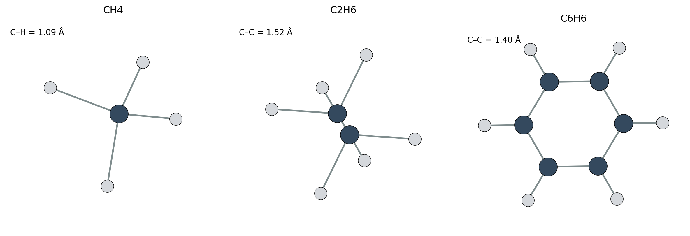
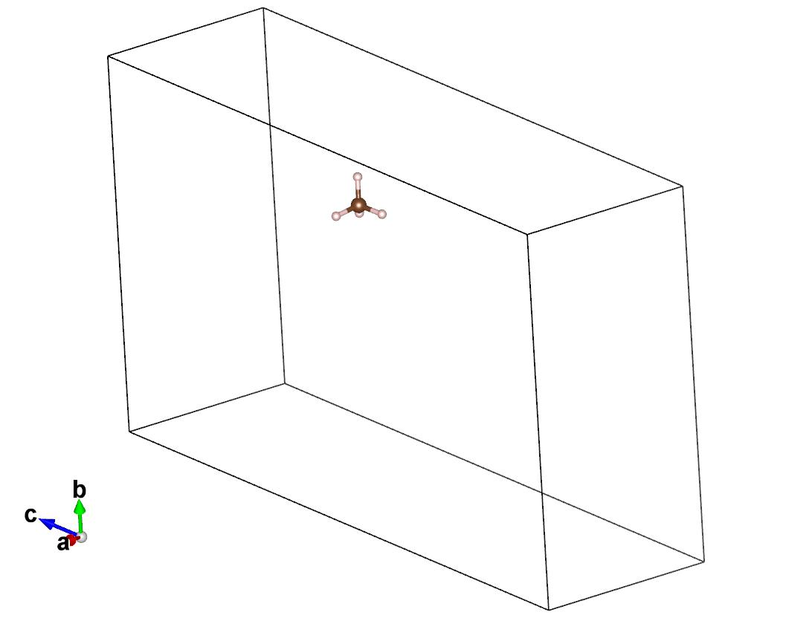

# 第 3 章：吸附质准备（CH4 / C2H6 / C6H6）

## 本章目的

学完这一章，你应该能：

- 把实验分子转成计算输入（XYZ、电荷、自旋、构象）；
- 判断哪些构象/电子态需要显式处理；
- 准备“参考分子”输入（同晶胞、同坐标、同截断）；
- 知道为什么参考能错一点，E_ads 就会全错。

图 3-1：三个基准分子的几何（ASE build.molecule；C 深灰、H 浅灰）。苯环是平面结构，C–C 约 1.40 Å。

图 3-2：同晶胞参考（VESTA）。晶胞还是复合物的 18.266 Å 原胞，只是把 106 个骨架原子删掉，CH4 留在原来的坐标上。

参考分子不是“放进一个 20 Å 大盒子”，而是放在与复合物**完全相同的晶胞、完全相同的坐标**里，只把骨架原子删掉。这样参考能和复合物才在同一个静电环境里。

> 这一点是整章最容易错、代价最大的一步。20 Å 盒子并不会让参考能“更干净”，反而会让它和复合物不在同一个晶胞里。见下面步骤 4 的实测数字。

## 计算背景速查

| 词 | 计算含义 | 为什么重要 |
|---|---|---|
| 构象采样 | 计算里固定哪一个构象，或采样几个 | 乙烷交叉/重叠能量不同 |
| 总电荷 charge | QE 输入里的分子总电荷；决定电子数 | 带错电荷，能量全错 |
| 多重度 multiplicity | 2S+1；与 nspin 配套 | CH4/C2H6/C6H6 都是 1 |
| 气相参考能 | 同一分子在**同一晶胞、同一坐标**、同一截断下的单点能量 | E_ads 的基准；晶胞或坐标变了，参考能就不配套 |
| BSSE | 两套基组叠在一起造成的假稳定 | 苯这种大分子要注意 |
| 参考晶胞 | 放参考分子的晶胞 | 必须与复合物一致；不要单独换大盒子 |

## 做法

### 步骤 1：建分子

- Avogadro：画 CH4/C2H6/C6H6，加 H，UFF/MMFF94 预优化，导出 XYZ；
- 或 ASE：

    .venv_mace/bin/python -c "from ase.build import molecule; from ase.io import write; m=molecule('CH4'); write('CH4.xyz', m)"

### 步骤 1b：Avogadro 里具体怎么建

1. File → New，Build → Add → Fragment，选 CH4/C2H6/C6H6 模板（或直接画）。
2. Build → Add Hydrogens，补满 H。
3. Extensions → Optimize Geometry，选 UFF 或 MMFF94，跑几十步。
4. 检查键长/键角；File → Save As → XYZ。
5. 记录你用的力场和构象；乙烷要说明交叉/重叠。

### 步骤 2：检查几何

- C–H 约 1.08–1.10 Å；
- C–C 约 1.52–1.54 Å；
- 苯环 C–C 约 1.39–1.40 Å，平面；
- 没有原子重叠，没有断键。

### 步骤 3：确认电荷/自旋

- CH4：中性，闭壳层，charge=0，multiplicity=1；
- C2H6：中性，闭壳层，charge=0，multiplicity=1；
- C6H6：中性，闭壳层，charge=0，multiplicity=1；
- 对应 QE：nspin=1。

### 步骤 4：准备参考能（最关键的一步）

**不要**把分子单独放进 20 Å 盒子算参考能。

QE 的总能量里有一部分与晶胞有关（G=0 项、平均静电势）。同一个 CH4，在 20 Å 立方盒子里是 -23.2036 Ry，在 18.266 Å 复合物原胞的同一位置是 -23.3425 Ry，差 0.139 Ry ≈ 1.89 eV。这个差**不会**在 E_ads 里抵消，会直接变成 1.9 eV 的假吸附。

正确做法：

1. 复制复合物 CIF；
2. 只删掉骨架原子，分子原子一个不动、分数坐标不改、晶胞不改；
3. 用与复合物**完全相同**的截断、degauss、conv_thr、赝势、D3 跑单点；
4. 记 E_ref。

这样 E_complex、E_bare、E_ref 三项才在同一个晶胞、同一套参数下，E_ads 才有意义。

每个位点都要单独做一份参考，因为分子坐标不同。脚本里对应 `one_click_mof/tools/make_same_cell_ref.py`，基准算例里对应 `run_mof5_finish.py` 自动生成的 `refs/same_cell/*.cif`。

## 参数表

| 参数 | 作用 | 默认 | 怎么调 |
|---|---|---|---|
| charge | 分子总电荷 | 0 | 只有离子体系才改 |
| multiplicity | 2S+1 | 1 | 开壳层才 >1；改了要设 nspin=2 |
| 参考晶胞 | 参考分子的晶胞 | 与复合物相同 | 不要单独换盒子；换了必须重算复合物 |
| nspin | QE 自旋 | 1 | 闭壳层 1；开壳层 2 |
| vdw_corr | 色散校正 | grimme-d3 | 苯必须开；否则严重低估 |
| 构象 | 乙烷交叉/重叠 | 交叉 | 至少比较一次，确认差多少 |

## MOF-5 基准算例

### 输入文件

| 文件 | 原子数 | 说明 |
|---|---|---|
| inputs/CH4.xyz | 5 | 主教学分子 |
| inputs/C2H6.xyz | 8 | 乙烷，交叉构象 |
| inputs/C6H6.xyz | 12 | 苯，平面 |

### 几何检查表（已生成）

| 分子 | 键 | 长度 (Å) | 备注 |
|---|---|---|---|
| CH4 | C–H | 1.09 | 正四面体 |
| C2H6 | C–C | 1.524 | 交叉构象 |
| C2H6 | C–H | 1.093 | — |
| C6H6 | C–C | 1.395 | 平面六元环 |
| C6H6 | C–H | 1.087 | — |

> 本节时间：3 个参考单点约 5–10 min（6 MPI，50/400，Γ），加输入检查约 10–20 min。详见 tutorial/benchmark/mof5/TIMING.md。

> 这些是 ASE 模板几何，不是 DFT 优化结果；正式计算前可用 Avogadro/UFF 再优化，并在报告里注明构象/力场。

### 参考能（同晶胞、同坐标）

| 分子 | site | 参考晶胞 | 截断 | degauss | E_ref (Ry) | 状态 |
|---|---:|---|---|---:|---:|---|
| CH4 | 3 | 18.266 Å 原胞 | 50/400 | 0.02 | -23.34254803 | 已复核 |
| C2H6 | 21 | 18.266 Å 原胞 | 50/400 | 0.02 | -44.32768426 | 已复核 |
| C6H6 | 17 | 18.266 Å 原胞 | 50/400 | 0.02 | -118.75158483 | 已算 |

> 每个位点一份参考：分子坐标不同，E_ref 就不同。

### 命令（从复合物生成同晶胞参考）

    # 1) 删掉骨架，只保留最后 5 个原子（CH4），晶胞和坐标不变
    .venv_mace/bin/python one_click_mof/tools/make_same_cell_ref.py \
        --complex complexes/CH4_site03.cif --n-mol 5 --out refs/CH4_site03_ref.cif

    # 2) 生成 QE 单点输入，参数必须和复合物完全一致
    .venv_mace/bin/python make_qe_input.py \
        --cif refs/CH4_site03_ref.cif --out scf/ref_CH4_site03/mof.in \
        --mode scf --ecutwfc 50 --ecutrho 400 --degauss 0.02 --conv-thr 1e-4 \
        --nspin 1 --pseudo-dir pseudo_sssp --outdir ./tmp --prefix mof

> 网页里对应“工具与参数 → 同晶胞参考（ASE）”：选复合物 CIF，填分子原子数（CH4=5、C2H6=8、C6H6=12）或骨架原子数（MOF-5 原胞=106），输出 `reference.cif` 和 `same_cell_ref.json`。  
> 基准算例里也不用手敲：网页“工具与参数 → 同晶胞参考（ASE）”已经覆盖这一步；0.1.0 仓库不附带私有基准批处理脚本。

## 怎么判断成功

- 分子几何合理，没有断键/重叠；
- 电荷/自旋与化学直觉一致；
- 参考分子与复合物同晶胞、同坐标（删骨架前后分子坐标没变）；
- 参考能与复合物用同一套参数；
- 你知道 E_ref 的单位是 Ry 还是 eV。

## 常见错误

| 现象 | 原因 | 处理 |
|---|---|---|
| E_ads 偏 4–5 eV | 参考能错/原子顺序错 | 检查参考分子和赝势顺序 |
| 苯的 E_ads 特别负 | 没开 D3 或 BSSE | 开 grimme-d3；做 BSSE 讨论 |
| 乙烷能量随构象变很多 | 用了不同构象 | 固定一个构象，或都算 |
| 参考用单独的大盒子 | 晶胞/位置不一致，E_ref 偏 1–13 eV | 改用同晶胞、同坐标参考 |
| 分子带错电荷 | charge/multiplicity 错 | 重新确认电子数 |

## 练习

1. 用 Avogadro 建苯，导出 XYZ，和 ASE 的 C6H6.xyz 比较键长。
2. 同一个 CH4 位点，分别用 20 Å 盒子和同晶胞参考算 E_ref，比较 E_ads 差多少。
3. 解释为什么 C6H6 的 BSSE 比 CH4 更值得担心。

## 练习答案

1. 苯的 C–C 约 1.39–1.40 Å，C–H 约 1.08 Å；Avogadro 与 ASE 的差异通常 <0.02 Å。若差异很大，检查力场/是否加了 H/是否平面。
2. 20 Å 盒子 -23.2036 Ry，同晶胞同位置 -23.3425 Ry，差 0.1389 Ry ≈ 1.89 eV；E_ads 从 -0.72 eV 变成 -2.61 eV。盒子更大并不意味着更对：关键是参考和复合物必须在同一个晶胞里。
3. 苯有 12 个原子、42 个电子，空间范围大，与骨架的基组重叠更多；π–π/色散也更强，所以 BSSE 比 CH4 更值得担心。可用 counterpoise 或更大基组检查。

## 本章产出

三个分子的 XYZ + 一张几何检查表 + 每个位点一份同晶胞参考能。  
下一章：04_sites.md。
