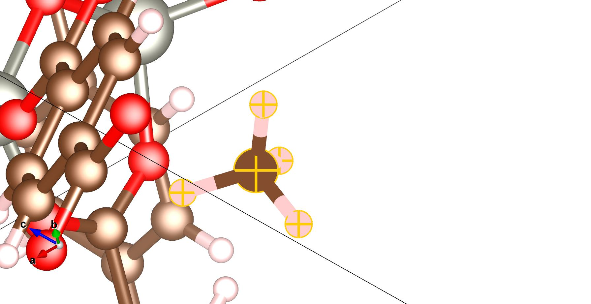
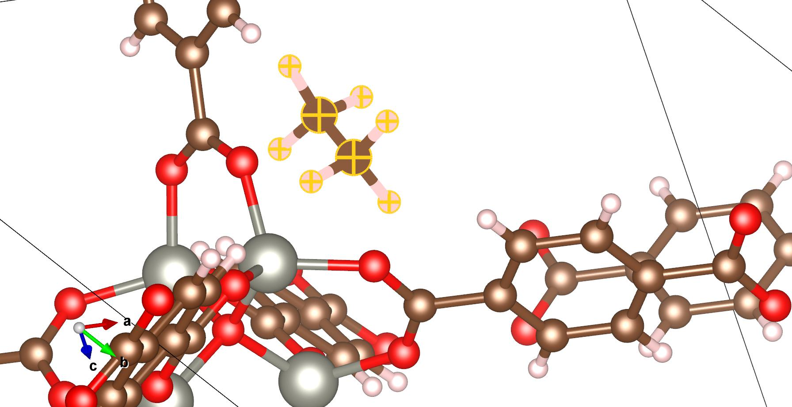
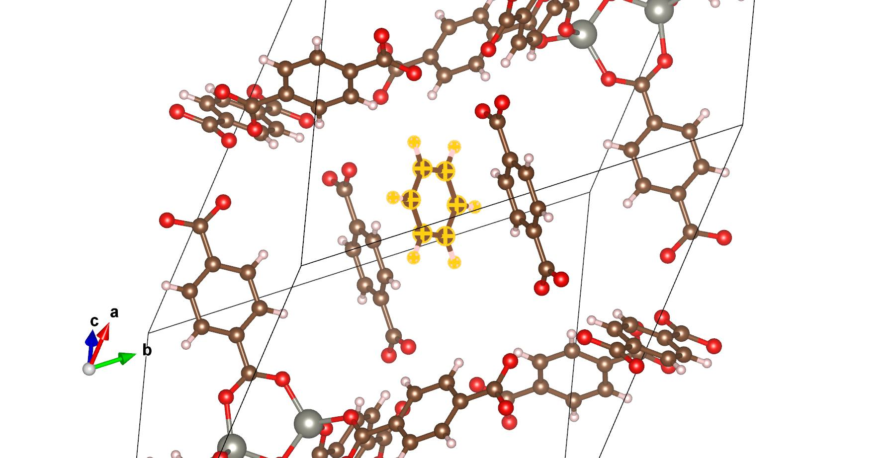

# 第 4 章：吸附位点搜索

## 本章目的

学完这一章，你应该能：

- 把孔道/位点概念转成可计算的候选结构；
- 用几何法/随机法/MLIP 法找候选位点；
- 设置 probe、网格间距、取向、seed；
- 判断位点是不是“真的在孔里”，而不是嵌进骨架。

## 计算背景速查

| 词 | 计算含义 | 为什么重要 |
|---|---|---|
| 可及孔道 / void | 计算里用探针/网格判断的“分子能到达的空间” | 与实验孔容/探针分子有关，但不是同一个量 |
| 探针 / probe | 用一个假想小球滚过孔道，判断哪里能放分子 | probe 太小会找到假位点 |
| 网格 / grid | 在晶胞里按一定间距撒点 | 间距越大越快，但可能漏位点 |
| 取向 / orientation | 分子朝哪个方向 | 苯的平面方向很关键 |
| 局域优化 | 从起点附近找一个能量低谷 | 不是全局最优 |
| 简并位点 | 对称性等价的多个位点 | 不要当成多个不同位点 |
| intact | 分子没断键/没变形 | 断了的位点要丢掉 |

## 做法

### 方法 1：手工放（VESTA/Avogadro）

适合：先看懂孔道、验证工具、分子很大。
步骤：

1. VESTA 打开 MOF；
2. 在孔道中央放一个分子；
3. 调整取向，避免和骨架重叠；
4. 导出 XYZ/CIF；
5. 用 QE 单点或 MACE 局域优化。

### 方法 2：几何网格 + 随机取向

适合：批量、可复现。
步骤：

1. 在晶胞内按 spacing 撒点；
2. 去掉离骨架小于 probe 的点；
3. 每个点随机取向放分子；
4. 碰撞检查（最近原子距离）；
5. 局域优化；
6. 按 E_ads 排序，保留 intact。

### 方法 3：MLIP 预筛

适合：位点多、想快速排序。
步骤：

1. 选模型（MACE/UFF）；
2. 固定骨架，只优化分子；
3. 多 seed 重复；
4. 取 top 位点做 DFT。

## 参数表

| 参数 | 作用 | 默认 | 怎么调 |
|---|---|---|---|
| spacing | 网格间距 | 1.2 Å | 小分子 1.0–1.2；大分子 1.5 |
| probe | 离骨架最小距离 | 2.2 Å | 太小会嵌进骨架；太大漏小孔 |
| n_sites | 候选起点数 | 24 | 先 24；不够加到 48/100 |
| seed | 随机种子 | 固定 | 换 seed 检查位点是否稳定 |
| orientation | 随机/指定 | 随机 | 苯要额外采样平面取向 |
| fmax | 局域优化力阈值 | 0.05 eV/Å | 预筛可松；DFT 要更紧 |
| maxstep | 优化步长 | 0.1 Å | 太大易崩；太小慢 |
| collision cutoff | 最小接触距离 | 1.6 Å | 小于这个直接丢 |

## MOF-5 基准算例

### 目标

- 结构：IRMOF-1_primitive.cif（106 原子）。
- 分子：CH4（先做）、C2H6、C6H6。
- 位点数：每个分子 24 个起点。
- seed：固定（例如 20261106），保证可复现。

### 当前工具状态

- `one_click_mof/tools/screen_adsorbate_mace.py` 已支持任意分子：内置 CH4/C2H6/C6H6/CO2，或用 `--adsorbate-file` 给自定义 XYZ。
- 它做的是“随机撒点 + MACE 局域优化 + 按 E_ads 排序”，输出 `screen.csv`、`best.cif` 和每个位点的 `site_XX.cif`。
- 只筛位点，不替代 DFT；MACE 与 DFT 的排序可能不同（见第 5 章）。

### 预期输出

screen.csv 至少包含：

| 列 | 含义 |
|---|---|
| site | 位点编号 |
| adsorbate | 分子名（CH4/C2H6/C6H6/CO2） |
| e_ads | 预筛吸附能（eV） |
| fmax_mol | 分子最大力（eV/Å） |
| min_mol_framework | 分子到骨架最近距离（Å） |
| min_mol | 分子内部最近原子距离（Å），用于发现变形 |
| bond_max_dev | 分子内部键长相对初始几何的最大偏差（Å） |
| intact | 分子是否完整 |
| cx,cy,cz | 起点坐标 |

### 结果表（MACE 已跑，2026-11-07）

| 分子 | 起点数 | intact 数 | 最低 E_ads (eV) | 最高 E_ads (eV) | 备注 |
|---|---:|---:|---:|---:|---|
| CH4 | 24 | 24 | -0.1876 (site 3) | -0.0004 | 主教学 |
| C2H6 | 18 | 18 | -0.2589 (site 20) | -0.0016 | 构象 |
| C6H6 | 15 | 15 | -0.2701 (site 17) | -0.0368 | 取向 |

> C2H6/C6H6 的 24 个起点里有一部分与骨架重叠被丢弃，所以有效起点是 18/15。MACE 只用于找位点，不能当最终 E_ads。

图 4-1：CH4 在 site 3 的吸附构象（VESTA，黄色十字是选中的 CH4 原子，用来在整幅骨架里一眼找到它）。CH4 落在 Zn4O 节点附近的孔壁上，最近 H···O 约 2.7 Å，属于典型物理吸附距离。MACE 给 −0.188 eV。

图 4-2：C2H6 在 site 21。乙烷比甲烷长，会同时接触两侧孔壁；图中跨晶胞边界的部分是周期性镜像，不是第二个分子。MACE 最佳其实是 site 20（−0.259 eV），这里展示的是 DFT 修正后更低的 site 21，正好用来说明“MLIP 排序 ≠ DFT 排序”。

图 4-3：C6H6 在 site 17。苯环近似平躺在孔道里，与骨架的接触面积比 CH4 大，所以色散贡献更明显。MACE 给 −0.270 eV，是三个分子里最负的。

## 怎么判断成功

- 位点在孔道里，不在骨架内部；
- 分子没有断键/严重变形；
- 至少 10 个 intact 位点；
- 换一个 seed，top 位点仍然出现（或解释为什么变）；
- 位点能量分布不是只有一个点（说明采样够了）。

## 常见错误

| 现象 | 原因 | 处理 |
|---|---|---|
| 所有位点 E_ads 都很负 | 分子嵌进骨架/重叠 | 加大 probe/collision cutoff |
| 只有一个位点 | 采样太少/都收敛到同一处 | 加 n_sites、换 seed |
| 位点全在孔外 | 网格点在晶胞外/没考虑 PBC | 用分数坐标，检查 MIC |
| 苯的结果很乱 | 取向采样不足 | 对苯单独采样平面取向 |
| intact=0 | 力场/模型不合适 | 换模型或手工放 |

## 练习

1. 用 VESTA 在 MOF-5 孔里放一个 CH4，导出 XYZ。
2. 把 probe 从 2.2 改到 2.6，看位点数怎么变。
3. 换一个 seed，比较 top 5 位点是否重叠。

## 练习答案

1. 在 VESTA 里把 CH4 放在孔道中央，调整取向使最近 CH4–骨架距离 >2.2 Å；导出 XYZ 后检查 C–H 仍约 1.09 Å、没有原子重叠。
2. probe 2.2→2.6 会删掉离骨架较近的点，位点数减少；可能漏掉窄孔窗。若位点数降到 0 或很少，说明 probe 太大或孔道被溶剂堵住。
3. 换 seed 后 top 5 若仍落在相同孔区，说明采样稳定；若完全不重叠，说明 n_sites 不够或能量面很平，需要加起点/多 seed，并在报告里写位点不确定性。

## 本章产出

每个分子一张位点表 + 一张最稳位点的结构图。  
下一章：05_mlip.md。
