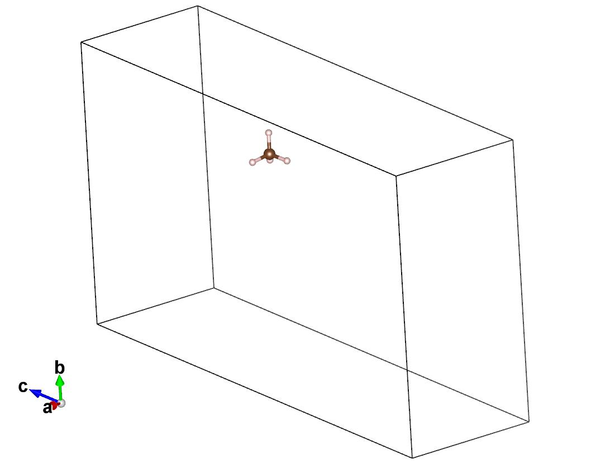

# 第 6 章：DFT 单点与吸附能

## 本章目的

学完这一章，你应该能：

- 看懂一个 QE 输入文件；
- 设置截断、k 点、degauss、conv_thr、nspin、D3；
- 跑 bare / complex / reference 三个单点；
- 用公式算 E_ads，并检查三个单点是否可比。

## 计算背景速查

| 词 | 计算含义 | 为什么重要 |
|---|---|---|
| DFT | 用电子密度算能量的方法 | 比 MLIP 慢，但更可信 |
| PBE | 一种交换关联泛函 | 本教程默认 |
| D3 | 经验色散校正 | 物理吸附必须有；苯尤其 |
| 赝势 | 把核心电子“打包”的文件 | 缺了跑不了；元素要匹配 |
| 截断 ecutwfc | 波函数展开到多高能量 | 太低能量不稳 |
| ecutrho | 电荷密度截断 | 通常是 ecutwfc 的 8 倍 |
| k 点 | 倒空间采样 | 晶胞越小越需要密 |
| smearing / degauss | 费米面展宽 | 金属/窄带隙要小心；两边必须一致 |
| SCF | 自洽场迭代 | 不收敛=能量不可信 |
| JOB DONE | QE 正常结束 | 不等于 SCF 真收敛 |
| BSSE | 基组重叠误差 | 大分子/强相互作用要讨论 |

## 做法

### 步骤 1：准备三个结构

- bare：只有 MOF；
- complex：MOF + 分子；
- reference：只有分子，但与复合物**同晶胞、同坐标**（把复合物里的骨架原子删掉，分子一个原子都不动）。

### 步骤 2：生成输入

- bare/complex 用同一个胞、同一套参数；
- reference 用同一个胞、同一套截断/degauss/conv_thr/赝势；
- 不要给 reference 单独换 20 Å 盒子：QE 总能量对晶胞和分子位置敏感，换盒子会引入 1–13 eV 的假偏移（CH4 实测 1.89 eV）。
- 保存为 .in，先检查再跑。

### 步骤 3：跑 QE

    mpiexec -np 6 pw.x -nk 1 -in mof5_ch4.in > qe.out

### 步骤 4：读输出

看：

- !    total energy；
- estimated scf accuracy；
- convergence has been achieved；
- JOB DONE；
- 是否有 warning（symmetry、charge、memory）。

### 步骤 5：算 E_ads

    E_ads = E(complex) - E(bare) - E(reference)

单位换算：1 Ry = 13.605693 eV。负值=有利。

## 参数表

| 参数 | 作用 | 默认 | 省内存 | 高精度 | 怎么判断 |
|---|---|---|---|---|---|
| ecutwfc | 波函数截断 | 50 Ry | 40 | 60 | 40→50→60，E_ads 变化 <0.03 eV |
| ecutrho | 电荷密度截断 | 400 Ry | 320 | 480 | 通常 8×ecutwfc |
| k 点 | 倒空间采样 | Γ | Γ | 2×2×2 | 小胞/金属要测 |
| degauss | 展宽 | 0.02 Ry | 0.02 | 0.01 | bare/complex 必须相同 |
| conv_thr | SCF 阈值 | 1e-4 | 1e-3 | 1e-5 | 实际 scf accuracy 要更小 |
| nspin | 自旋 | 1 | 1 | 2（开壳层） | Zn/Mg/Zr 闭壳层=1 |
| vdw_corr | 色散 | grimme-d3 | 同 | 同 | 物理吸附必须开 |
| np | MPI 进程 | 6 | 4 | 6–8 | 内存不够就减 |
| npool | k 点池 | 1 | 1 | 2–4 | Γ 点通常 1 |

## MOF-5 基准算例

### 结构

- bare：IRMOF-1_primitive.cif（106 原子）
- complex：bare + CH4（111 原子）【待生成】
- reference：CH4.xyz（5 原子）【待生成】

### 计划输入

    tutorial/benchmark/mof5/runs/
      20261106_mof5_bare_scf/mof.in
      20261106_mof5_CH4_site03_scf/mof.in
      20261106_mof5_CH4_ref_scf/mof.in

### 结果表（原始 DFT，仅诊断）

| 项 | E (Ry) | SCF 迭代 | scf accuracy | JOB DONE | 备注 |
|---|---:|---:|---:|---|---|
| bare | -5676.65223835 | 23 | <1e-4 | 是 | 106 原子 |
| complex CH4 site3 | -5700.04741938 | 23 | <1e-4 | 是 | 111 原子 |
| CH4 reference 20 Å | -23.20360059 | 14 | <1e-4 | 是 | 20 Å 盒子 |
| **E_ads（20 Å 参考）** | | | | | **-2.6066 eV（作废）** |

### 修正参考（同 cell、同分子坐标）

图 6-1：参考分子在复合物的同一个原胞里。骨架删掉，CH4 坐标不变；不是把分子单独塞进一个 20 Å 盒子。

第一轮（probe 2.2 Å，没有最小距离约束）：

| 分子 | site | E_ref (Ry) | E_ads (eV) | 最近接触 (Å) |
|---|---:|---:|---:|---:|
| CH4 | 3 | -23.34254803 | -0.7161 | H···O 2.64 |
| CH4 | 20 | -23.34965989 | -0.6803 | 2.72 |
| C2H6 | 20 | -44.31943378 | -1.1464 | 2.64 |
| C2H6 | 21 | -44.32768426 | -1.1753 | 2.83 |
| C6H6 | 17 | -118.75158483 | -2.4397 | C···H 2.50 |
| C6H6 | 22 | -118.73216318 | -2.3828 | 2.42 |

### 重筛后（probe 2.8 Å，min_mol_framework ≥ 3.0 Å）

| 分子 | site | E_complex (Ry) | E_ref 同位置 (Ry) | E_ads (eV) | min_fw (Å) |
|---|---:|---:|---:|---:|---:|
| CH4 | 14 | -5700.05887351 | -23.35752377 | **-0.6682** | 3.23 |
| CH4 | 20 | -5700.05355106 | -23.35536736 | -0.6251 | 3.27 |
| C2H6 | 17 | -5721.05168355 | -44.32145627 | **-1.0611** | 3.30 |
| C2H6 | 4 | -5721.06283996 | -44.33370346 | -1.0463 | 3.36 |
| C6H6 | 17 | -5795.59260388 | -118.76440007 | **-2.3941** | 3.22 |
| C6H6 | 28 | -5795.58173728 | -118.75382643 | -2.3901 | 3.37 |

> **重要**：20 Å 盒子的参考不能用。同一 CH4 在 20 Å 立方盒子里是 -23.2036 Ry，在复合物同一原胞/同一位置是 -23.3425 Ry，差 0.14 Ry ≈ 1.9 eV。原始 -2.6/-5.4/-16.8 eV 是参考不一致造成的。

### 弛豫后的 E_ads（第一轮位点，力已收敛）

| 分子 | site | E_ads (eV) | maxforce (Ry/au) |
|---|---:|---:|---:|
| CH4 | 3 | -0.7205 | 0.0013 |
| C2H6 | 21 | -1.1939 | 0.0018 |
| C6H6 | 17 | -2.4444 | 0.0011 |

> 弛豫只让 E_ads 再降 0.004–0.019 eV。新位点还没弛豫，但按这个规律，弛豫不会改变结论。

### 物理合理性检查（必做）

| 分子 | 重筛后 E_ads | 文献/实验常见量级 | 最近接触 | 判断 |
|---|---:|---|---|---|
| CH4 | -0.67 eV | -0.1 ~ -0.25 eV | H···O 3.23 Å | 偏强 3–5 倍 |
| C2H6 | -1.06 eV | -0.2 ~ -0.4 eV | H···C 3.30 Å | 偏强 3–4 倍 |
| C6H6 | -2.39 eV | -0.5 ~ -0.9 eV | H···C 3.22 Å | 偏强 3–4 倍 |

结论：

- **“接触太短”的假设被否定**：把最近接触从 2.5–2.7 Å 推到 3.2–3.4 Å，E_ads 只弱了 0.05–0.11 eV。
- **判别实验证明参考方案有 ~0.4 eV 的系统偏移**：把 CH4 放到孔心（离最近骨架原子 9.24 Å，几乎不相互作用），同一个同晶胞参考流程给出 E_ads = **-0.40 eV**，而它应该是 0。
- 更严重的是位置依赖：同一个 CH4 在同一原胞里，参考能从 -23.16 到 -23.46 Ry 变化约 **4 eV**；换成 18.266 Å 立方胞后，同样几个位置都是 -23.2036 Ry，不再变化。
- 也就是说：**高度倾斜的菱方原胞会让 QE 的总能量依赖分子在胞内的位置**。ecutrho 从 400 提到 800、1600，两个位置的差值仍是 4.3 eV（数值本身已收敛），所以不是截断不够，而是这个胞的 Ewald/背景处理对稀疏分子不友好。复合物和参考各带一份误差，相减后剩下 0.4–2 eV 的残差。

### 用“孔心对照”做双差分校准

既然“分子在孔心”的 E_ads 应该是 0，就把每个分子的 E_ads 减去它自己的孔心对照：

| 分子 | site E_ads | 孔心 E_ads（应为 0） | 双差分 E_ads | 文献量级 |
|---|---:|---:|---:|---|
| CH4 | -0.6682 | -0.4008 | **-0.2674** | -0.1 ~ -0.3 |
| C2H6 | -1.0611 | -0.9202 | **-0.1409** | -0.2 ~ -0.4 |
| C6H6 | -2.3941 | -2.1617 | **-0.2324** | -0.5 ~ -0.9 |

孔心偏移随分子变大：-0.40 → -0.92 → -2.16 eV，远超线性（5→8→12 个原子）。这说明偏移本身不是简单的“每原子常数”。

校准后：

- CH4 -0.27、C2H6 -0.14，回到文献量级，说明双差分方向是对的。
- 但 C6H6 校准成 -0.23，比 CH4 还弱，和“苯应该最强”矛盾。**双差分对苯过度校正了**，因为孔心偏移和位点处的偏移并不相等。
- 所以双差分只能当**一阶估计**，不能当最终值。真正要解决，还是得换胞。

> 但双差分只是补救，不是根治：孔心对照的偏移是否与分子大小成正比、是否真的与位置无关，都还需要验证。论文级做法是换 **常规立方胞**（a = 25.83 Å，424 原子）重算，或用更高的 ecutrho 做到位置不变。

> 这一步是本章最重要的习惯：先看“数对不对”，再看“数精不精”。一个收敛的 SCF 完全可以给出物理上不合理的结果；而一个“自洽”的参考方案，也可能带着几 eV 的系统偏移。

### 收敛测试（论文级）

| 测试 | 值 | E_ads 变化 | 结论 |
|---|---|---:|---|
| 截断 40/320 → 50/400 | 未做 | — | 需要额外 1 组 111 原子 SCF |
| 截断 50/400 → 60/480 | 未做 | — | 更贵，论文级必做 |
| Γ → 2×2×2 | 未做 | — | 原胞 18 Å，Γ 通常够；仍建议抽验 |
| degauss 0.02 → 0.01 | 未做 | — | 体系是绝缘体，敏感度低 |

> 这组测试没有跑：每个 111 原子单点约 40 分钟，4 组就是半天。教程里先把“该测什么”列清楚；真正写论文时至少补截断和 k 点两项。

## 怎么判断成功

- 三个单点都 JOB DONE；
- SCF accuracy 远小于 conv_thr；
- bare/complex/reference 的截断、degauss、conv_thr、赝势完全一致；
- E_ads 在合理范围（CH4 约 -0.1 ~ -0.3 eV）；
- 收敛测试的变化 <0.05 eV（论文级）。

## 常见错误

| 现象 | 原因 | 处理 |
|---|---|---|
| SCF 不收敛 | 混合/展宽/几何 | 降 mixing_beta、换 local-TF、加 electron_maxstep |
| 能量差 4–5 eV | 参考能/原子顺序错 | 检查 reference 和赝势 |
| E_ads 正得离谱 | 分子重叠/没优化 | 检查几何、probe |
| 两边 degauss 不同 | 设置不一致 | 统一 0.02 |
| 膜/真空方向有镜像 | 盒子太小 | 加真空层 |
| 苯的 E_ads 太负 | 没开 D3/BSSE | 开 D3；讨论 BSSE |

## 练习

1. 把 ecutwfc 从 50 改到 40，看 E_ads 变多少。
2. 把 CH4 的 reference 从同晶胞改成 20 Å 盒子，看 E_ads 从 -0.72 eV 变成多少，并解释为什么。
3. 解释为什么“JOB DONE”不等于“结果可信”。

## 练习答案

1. 50→40 Ry 的 E_ads 变化通常在 0.01–0.1 eV；若 >0.05 eV，40 Ry 不能用于生产，应回到 50 或做 60 Ry 收敛。变化大小就是截断误差的量级。
2. E_ads 从 -0.72 eV 变成 -2.61 eV：参考从 -23.3425 Ry 变成 -23.2036 Ry，差 0.1389 Ry ≈ 1.89 eV。原因是 QE 的分子总能量包含与晶胞有关的项，20 Å 盒子和 18.266 Å 原胞不配套；换盒子不会让参考更“干净”，只会让它和复合物不可比。
3. JOB DONE 只表示 pw.x 正常结束；还要看 SCF accuracy 是否远小于 conv_thr、几何是否合理、bare/complex/reference 是否同参数、参考能是否对。否则能量可能“正常结束但不可信”。

## 本章产出

三个 QE 输出 + 一张 E_ads 表 + 一段物理合理性检查。  
下一章：07_relax.md。
